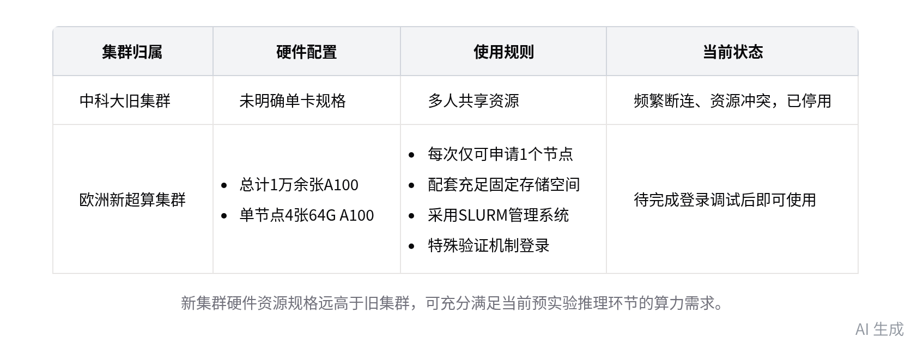
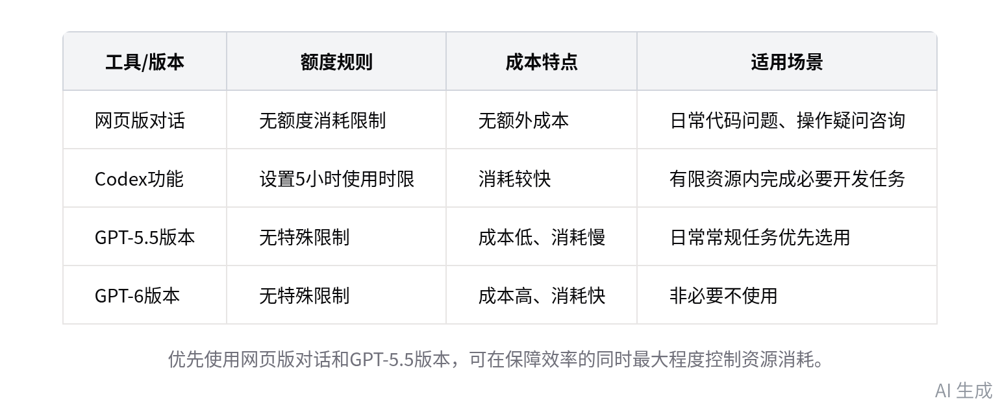

# 智能纪要：计算资源切换及相关工作部署会 2026年9月8日

> 会议主题：计算资源切换及相关工作部署会
> 
> 会议时间：2026年9月8日（周二） 20:14 \- 20:25 （GMT\+08）
> 
> 参会人：@史秋实@张锐寒
> 
> 

> 智能会议纪要由 AI 生成，可能不准确，请谨慎甄别后使用
> 
> 

# 总结

史秋实与张锐寒就计算资源切换、预实验推进、AI工具使用等事项沟通确认，相关工作安排及要求内容如下：

- **计算资源相关安排**

    - **旧集群与预实验进展**

        - 停用说明：原中科大集群频繁断连、多人共享资源冲突，无法保障计算任务稳定运行，明确停止使用。

        - 预实验状态：此前40G规格预实验的分段处理工作已全部完成，推理环节前置准备就绪，待新集群就绪即可启动。

    - **新集群核心配置**

        - 硬件参数：本次对接的为欧洲超算集群，总计配备 1 万多张 A100 显卡，单节点搭载 4 张 64G 规格 A100。

        - 资源规则：每次仅可申请 1 个节点资源，集群配套的固定存储空间可完全满足当前任务的使用需求。

    - **新集群使用要求**

        - 管理机制：集群采用 SLURM 管理系统，登录需特殊验证机制，非普通公私钥或密码验证，需自行查阅相关说明。

        - 操作规范：无需深究集群底层运行逻辑，操作疑问可直接咨询AI工具，避免误操作导致集群运行故障。

- **AI工具使用规范**

    - **额度管控规则**

        - 网页版权限：ChatGPT 网页版对话无额度消耗限制，日常代码编写、操作疑问等需求优先通过网页版咨询解决。

        - 功能限制：Codex 功能设置 5 小时使用时限，避免无意义资源消耗，后续产出合格成果后可申请放开无限量权限。

    - **模型选择建议**：日常任务优先选用 GPT\-5\.5 版本即可满足需求，无需使用消耗速度快、成本较高的 GPT\-6 版本。

- **后续工作计划**

    - **配置发送**：史秋实将在会后向张锐寒发送新超算集群的配置信息，便于其完成后续的登录与测试操作。

    - **使用学习**：张锐寒需自行研究新集群的使用方法，完成登录验证后即可启动预实验的推理环节工作。

# 待办

* [ ] 集群使用研究：研究 SLURM 集群管理工具的具体使用方法，了解其资源申请、运行调度规则，不懂可咨询 ChatGPT 辅助解决（来自史秋实） @张锐寒

* [ ] 配置信息发送：将服务器配置信息发送给张锐寒，该服务器采用特殊验证机制，使用过程中遇问题可咨询 AI 辅助解决 @史秋实

# 相关链接

- 文字记录

    - [计算资源切换及相关工作部署会 2026年9月8日](https://ecnb86bqz8no.feishu.cn/docx/EcrMdMApCoLX06xPLM5c3XR0nSc)

