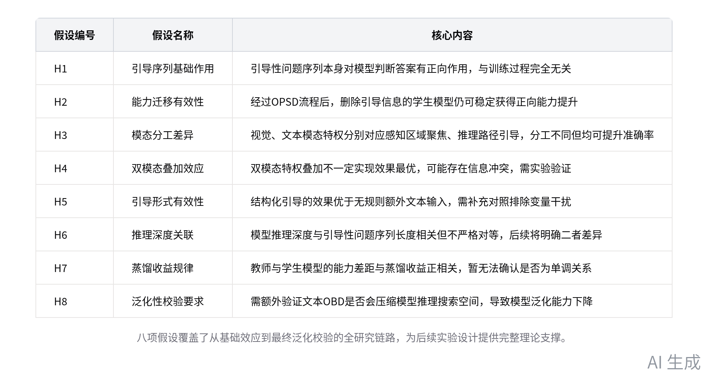
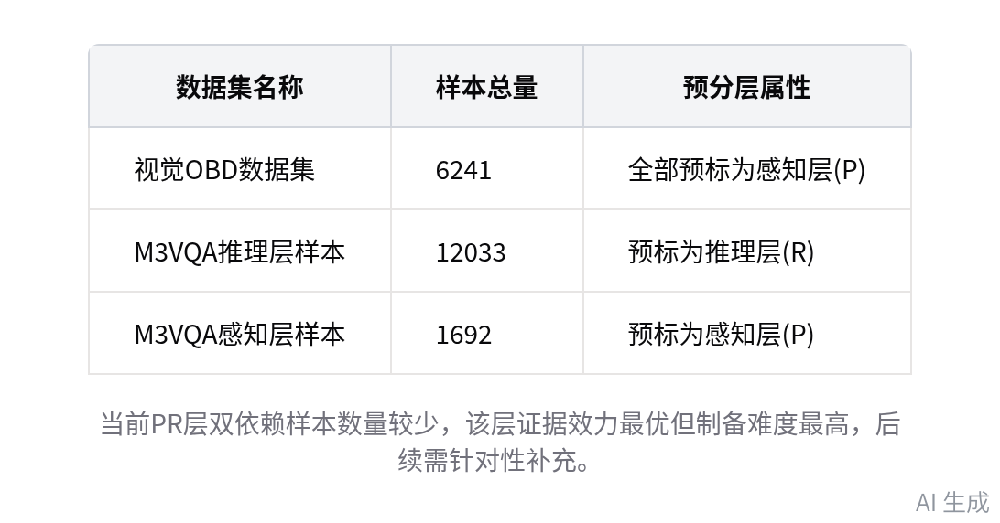

# 智能纪要：视觉问答模型蒸馏研究推进会 2026年9月10日

> 会议主题：视觉问答模型蒸馏研究推进会
> 
> 会议时间：2026年9月10日（周四） 22:54 \- 23:45 （GMT\+08）
> 
> 参会人：@史秋实@张锐寒
> 
> 

> 智能会议纪要由 AI 生成，可能不准确，请谨慎甄别后使用
> 
> 

# 总结

本次会议对齐文本模态增强的视觉问答模型蒸馏研究的方案、实验设计与数据进展，明确核心方向与落地优先级，内容如下：

- **研究假设与初始实验基础**

    - **初始验证结论**

        - 核心性能规律：控制变量下相同微训练模型，带引导性问题序列的性能优于无引导序列，该结论基于 1200 个测试样本得出。

        - 模型测试注意点：千问模型测试需关闭 thinking 模式，本次研究的能力增强为模型内化能力，不采用外部多轮调用的 CoT 嵌套方式。

        - 过往实验参考数据：史秋实提到视觉 OBD 方案在视觉模态上可实现二三十个点的提升，文本模态初步实验仅能实现两三个点的提升。

    - **八项核心研究假设**

        - 引导序列基础作用：引导性问题序列本身对模型判断答案有正向作用，该效应与模型训练过程完全无关。

        - 能力迁移有效性：经过 OPSD 流程后，删除引导信息的学生模型仍可稳定获得正向能力提升。

        - 模态分工差异：视觉、文本模态特权分别对应感知区域聚焦、推理路径引导，二者作用分工不同但均可提升准确率。

        - 双模态叠加效应：双模态特权叠加不一定实现效果最优，可能存在信息冲突，需通过实验实际验证。

        - 引导形式有效性：结构化引导的效果优于无规则额外文本输入，需补充对照排除变量干扰。

        - 推理深度关联：模型推理深度与引导性问题序列长度相关但不严格对等，后续将明确二者差异逻辑。

        - 蒸馏收益规律：教师与学生模型的能力差距与蒸馏收益正相关，暂无法确认二者是否为单调关系。

        - 泛化性校验要求：需额外验证文本 OBD 是否会压缩模型推理搜索空间，导致模型泛化能力下降。

- **实验设计框架**

    - **实验主线设置**

        - 双主线实验架构：Track A 为复现视觉 OBD 方案，验证现有数据体系有效性，不引入新研究变量；Track B 为核心研究线。

        - 对照组配置规则：文本模态对应随机无关引导、序列打乱、通用提示三类对照，视觉模态对应假裁剪对照，配套消融实验验证引导序列有效性。

        - 引导策略储备：已确定层级定位、关系链/实体链、证据整合三类核心引导问题生成策略，对应 prompt 已存储本地。

    - **数据分层规则**：按问题依赖能力划分为感知层（P）、推理层（R）、双依赖层（PR），其中 PR 层证据效力最优但制备难度最高。

- **数据处理进展**

    - **当前处理进度**

        - 整体进度说明：已完成数据集统一格式转换、初步分层的前序步骤，整体处理进度约 50%，相关内容已提交至代码仓库。

        - 流水线节点设置：共包含 9 个任务节点，覆盖数据集预处理、引导序列生成、多维度数据校验、人工审核、数据集冻结全流程。

        - 数据集切分规则：必须以原图为单位划分数据集，避免同一张图的不同问题分属训练、测试集导致结果失真。

    - **数据集来源说明**：除原有视觉 OBD 的 6241 个样本外，新增 M3VQA 数据集，含预标推理层样本 12033 个、感知层样本 1692 个。

- **核心指导建议**

    - **史秋实提出精简研究范围**：无需穷尽所有变量的排列组合验证，优先找到可直观提升教师模型能力的路径即可，效果达标后逻辑可自洽。

    - **史秋实明确赛道选择逻辑**：优先选择视觉相关的高门槛研究方向，避免进入文本类低门槛内卷赛道，提升研究成果竞争力。

    - **史秋实强调迭代效率要求**：无需在数据预处理环节过度耗时，先快速跑通核心流程验证效果，不及预期可直接调整方向。

- **后续工作计划**

    - 精简现有研究方案，砍掉非核心的冗余验证项，聚焦“提效教师模型→蒸馏学生模型”的核心目标

    - 剔除 M3VQA 数据集中需要外部知识介入的样本，快速推进数据处理全流程

    - 优先验证文本引导策略对教师模型的提效效果，及时输出核心指标数据

# 待办

* [ ] 核心事项梳理：梳理当前大模型相关研究的核心内容，砍掉非必要的冗余内容，聚焦提升学生模型在测试集上的表现相关工作（来自史秋实）

* [ ] 数据处理说明：向史秋实解释数据处理流水线的具体内容，说明文本模态问题的生成方式，同步当前数据集的处理进展（来自史秋实）

* [ ] M3VQA 数据处理：针对存在需外部信息介入问题的 M3VQA 数据集，直接剔除对应条目，验证处理后的数据效果，避免前期耗时过长（来自史秋实）

# 相关链接

- 文字记录

    - [视觉问答模型蒸馏研究推进会 2026年9月10日](https://ecnb86bqz8no.feishu.cn/docx/STZvdX7wGo3rH1xxTKMclq48nEe)

