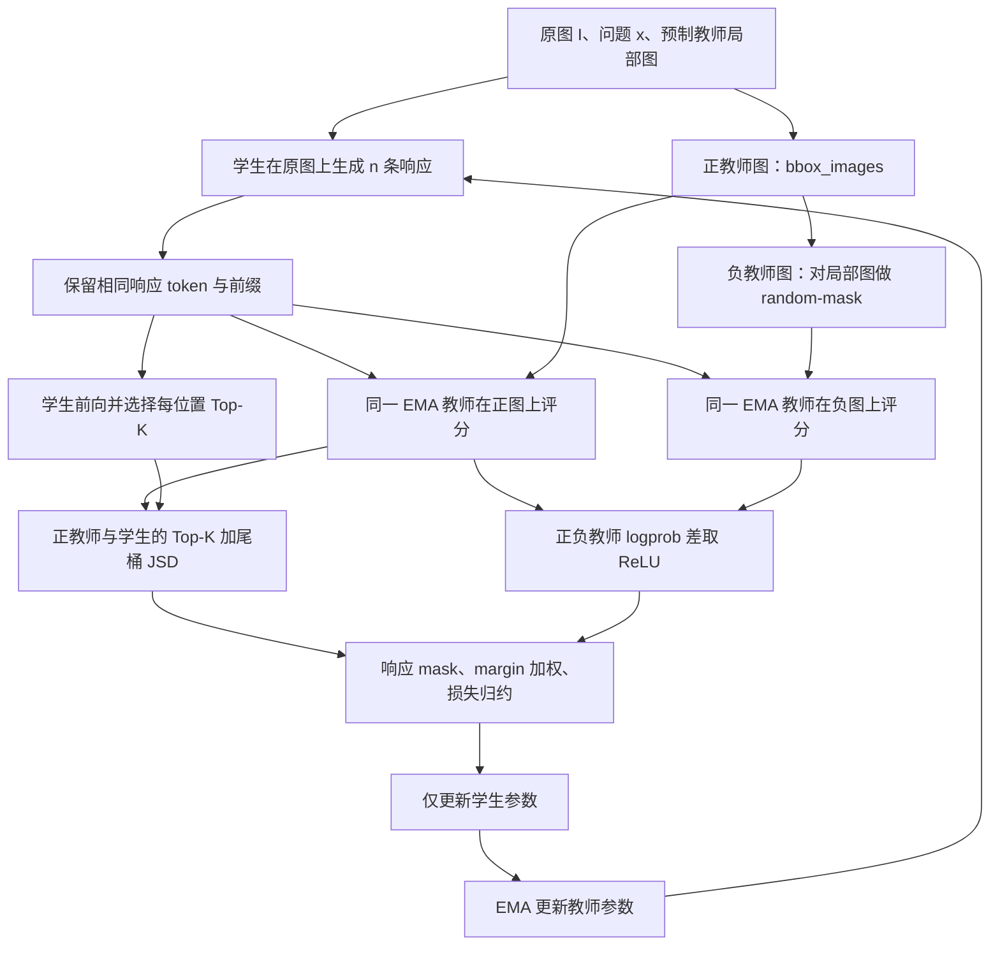
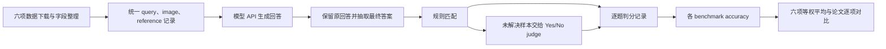

# OPD-V 代码、论文一致性与仓库解读报告

审计日期：2026-09-11。对象：公开 OPD-V 仓库的默认 Qwen3.5-4B 训练路径，以及当前六项评测复现流程。

**结论：核心算法在代码中确实存在，正负教师、同一学生轨迹、视觉 margin 加权、Top-K 加尾桶的 JSD、EMA 更新均能对应上。但不能据此宣称代码与论文完全等价，也不能证明公开权重由这份代码和默认参数精确训练得到。最值得优先处理的是损失归约：默认实现先在每个微批次按 token 平均，再按样本数累积梯度，通常不等价于论文的逐响应平均。另一个已验证的实现细节是 `random-mask` 每次重新使用种子 0，相同尺寸图片的遮挡位置不会随调用变化。**

本报告没有修改官方训练、推理或判分代码，没有启动训练，也没有重启、取消或调整正在进行的评测。新增内容只有审计脚本、报告和证据文件。

## 阅读导航

- 想判断“能否作为新项目基础”：先读第 1、5、10 节。
- 想理解算法如何落地：读第 2、3、4 节。
- 想解释当前分数为什么低于论文：读第 6、7 节，注意目前没有完成差异归因实验。
- 想复查证据：读第 8、9 节及代码行链接。

## 1. 审计版本、范围与判断标准

| 对象 | 固定版本或范围 |
|---|---|
| 官方代码 | `e49311586b000a9dc33bfc983a16a96de9e60002`；提交说明 `Fix evaluation answer judging` |
| 代码工作目录 | `/leonardo/home/userexternal/rqian000/sqs/OPD-V` |
| 主要论文 | [arXiv v2 PDF](https://arxiv.org/pdf/2608.05131v2)，18 页，题名 *OPD-V: Visual On-Policy Self-Distillation with Modality Balance* |
| 版本交叉核对 | [arXiv v1 PDF](https://arxiv.org/pdf/2608.05131v1)；本次核对涉及核心方法、算法和主表，不是全文版本差分 |
| 已下载训练后模型 | `aaniri/OPD-V-Qwen3.5-4B`；revision `e953298ef18b58bb8dea96f507adb9b16025d0d1` |
| 核心训练路径 | `scripts/run_opdv.sh` → Hydra 配置 → legacy/FSDP actor → self-distillation loss |
| 实证检查 | 静态调用链与配置追踪、实际函数的六组小规模 CPU 语义检查、当前评测产物核对 |
| 未完成的验证 | 从基础模型重新训练、多卡梯度等价性实测、训练数据逐图核验、论文图表全量重建、公开权重训练来源追溯 |

模型 README 使用了较早的题名及 v1 链接。这属于元数据需要统一，**不能据此认定权重有误**。本报告引用论文版本、代码 commit 和模型 revision 三个独立标识，避免把它们默认视为同一次实验。

判断标签：

| 标签 | 含义 |
|---|---|
| 对齐 | 在已追踪的默认执行路径中找到对应实现 |
| 确认差异 | 有明确代码证据，必要时有最小数值反例 |
| 细节未锁定 | 代码行为确定，但论文没有充分规定该细节 |
| 证据不足 | 需要训练记录、数据或额外实验；不能从代码存在与否直接推断 |

本仓库是包含大量训练框架代码的快照。审计深度集中在 OPD-V 实际调用链，不代表逐行验证了全部 11 万行代码，也不是安全审计或所有模型后端的兼容性认证。

## 2. 仓库结构：哪些文件值得先读

`git ls-files` 统计有 **486 个跟踪文件**，其中 `verl/` 有 **468 个**，`scripts/` 有 6 个，`eval/` 有 5 个。按 `.py/.yaml/.toml/.md/.sh/.jinja/.txt` 统计约 **114,091 行文本**，包括注释与配置。当前本地 `reproduction/` 不在官方提交内。

```text
OPD-V/
├── README.md                    使用说明、模型/数据链接、训练评测命令
├── pyproject.toml               包元数据与安装入口
├── requirements.txt             环境依赖列表
├── chat_templates/
│   └── perception_chat_template_qwen35.jinja
├── scripts/
│   ├── prepare_data.py          Vision-OPD 数据 → 训练 parquet
│   ├── run_opdv.sh              默认 OPD-V 训练入口与关键覆盖参数
│   ├── merge_checkpoint.sh      FSDP checkpoint → HF 模型目录
│   ├── rebuild_opdv_apptainer.sh 容器环境辅助脚本
│   ├── upload_wandb.sh          日志同步辅助入口
│   └── upload_training_to_wandb.py
├── eval/
│   ├── prepare_data.py          六项 benchmark 格式统一
│   ├── infer.py                 OpenAI-compatible API 推理与续跑
│   ├── judge_qwenlm.py          规则匹配与 Yes/No 判分
│   ├── cal_acc.py               各 benchmark 正确率与分类统计
│   └── run_eval.sh              prepare → infer → judge → accuracy
├── verl/
│   ├── protocol.py              DataProto：张量、非张量、元信息的容器
│   ├── trainer/
│   │   ├── main_ppo.py          Hydra/Ray 训练启动、worker 选择
│   │   ├── config/             训练、actor、rollout、模型等分层配置
│   │   └── ppo/
│   │       ├── ray_trainer.py   全局训练调度、教师输入、奖励旁路
│   │       └── core_algos.py    蒸馏损失、归约及通用 PPO/GRPO 算法
│   ├── workers/
│   │   ├── fsdp_workers.py      模型初始化、分布式切分、教师挂接
│   │   ├── actor/dp_actor.py    前向、正负教师评分、反向、EMA
│   │   ├── config/             worker 配置数据类
│   │   └── rollout/            vLLM 等生成后端
│   ├── models/                 模型适配与分布式模型代码
│   ├── utils/                  数据集、张量、日志、checkpoint 等工具
│   ├── model_merger/           分片权重合并实现
│   ├── experimental/           可选/实验框架组件
│   └── ...                     控制器、工具交互、第三方兼容代码
└── reproduction/               本地复现层，不属于上面的官方 commit
    ├── suite_config.py         六项数据与论文对照参数
    ├── download_suite.py       下载与准备调度
    ├── run_suite.py            离线环境中的官方推理适配
    ├── judge_suite.py          当前规则 + Codex 判分
    ├── continue_suite.py       后续评测流水线
    ├── suite.sbatch            Leonardo 双 A100 作业
    └── audit/                  本报告和 CPU 语义检查脚本
```

框架主要目录文件数：`utils` 108，`experimental` 115，`workers` 70，`models` 65，`trainer` 60。它们的规模不等于 OPD-V 新算法的代码量；没有锁定对应上游 verl 基线，不能把这 468 个文件都算成作者新增实现。

| 阅读顺序 | 文件与入口 | 主要解决的问题 |
|---|---|---|
| 1 | [scripts/run_opdv.sh:15](/leonardo/home/userexternal/rqian000/sqs/OPD-V/scripts/run_opdv.sh:15) | 到底用哪个模型、哪些参数、哪条训练路径 |
| 2 | [scripts/prepare_data.py:70](/leonardo/home/userexternal/rqian000/sqs/OPD-V/scripts/prepare_data.py:70) | 原图、教师图、问题、答案分别放在哪里 |
| 3 | [verl/trainer/ppo/ray_trainer.py:1253](/leonardo/home/userexternal/rqian000/sqs/OPD-V/verl/trainer/ppo/ray_trainer.py:1253) | 学生生成后怎样构造两个教师输入 |
| 4 | [verl/workers/actor/dp_actor.py:1144](/leonardo/home/userexternal/rqian000/sqs/OPD-V/verl/workers/actor/dp_actor.py:1144) | 学生与教师怎样前向、对齐、更新 |
| 5 | [verl/trainer/ppo/core_algos.py:1084](/leonardo/home/userexternal/rqian000/sqs/OPD-V/verl/trainer/ppo/core_algos.py:1084) | 最终究竟优化什么数学量 |
| 6 | [verl/workers/actor/dp_actor.py:135](/leonardo/home/userexternal/rqian000/sqs/OPD-V/verl/workers/actor/dp_actor.py:135) | EMA 系数方向和更新时机 |
| 7 | [eval/run_eval.sh:20](/leonardo/home/userexternal/rqian000/sqs/OPD-V/eval/run_eval.sh:20) | 六项评测如何串起来 |
| 8 | [eval/judge_qwenlm.py:197](/leonardo/home/userexternal/rqian000/sqs/OPD-V/eval/judge_qwenlm.py:197) | 正确与错误如何判定 |

理解主方法不需要先读完 PPO/GRPO、所有 reward scorer 或所有 experimental 目录。

## 3. 从输入到参数更新：完整训练链路

### 3.1 数据转换与信息边界

[scripts/prepare_data.py:70](/leonardo/home/userexternal/rqian000/sqs/OPD-V/scripts/prepare_data.py:70) 的 `build_record()` 将外部训练数据转换为：

| 字段 | 内容 | 默认 OPD-V 用途 |
|---|---|---|
| `prompt` | 原始 `item["problem"]` | 学生和教师共享的文本问题 |
| `images` | `item["images"][0]` 的路径 | 学生原图 |
| `bbox_images` | `item["teacher_images"][0]` 的路径 | 正教师的预制局部图 |
| `reward_model.ground_truth` | `item["answer"]` | 元数据；默认无奖励 OPD-V 不靠它计算训练奖励 |
| `extra_info.answer` | 同一答案 | 辅助信息，不意味着已拼进教师 prompt |
| `extra_info.question` | `clean_question()` 的结果 | 辅助展示/信息字段 |

一个容易读错的地方：`clean_question()` 没有替换实际 `prompt`。训练问题保留原始 `problem`，因此其中的视觉定位/关注区域指令仍会进入模型。

代码消费数据集已经提供的教师图片，没有在这里从任意 bbox 坐标重新生成全部 crop。数据字段能对应上，不等于已验证每张教师图的框位置、放大倍率、图像版本和筛选过程。训练集本次没有逐样本审计。

### 3.2 训练控制流



1. `main_ppo.py` 启动 Ray trainer，选择 worker。当前 self-distillation 路径要求 legacy worker；不能只因仓库里存在另一种新引擎，就假定默认训练会调用它。入口校验见 [verl/trainer/main_ppo.py:139](/leonardo/home/userexternal/rqian000/sqs/OPD-V/verl/trainer/main_ppo.py:139)。
2. `RayPPOTrainer.fit()` 读取 batch，调用 rollout 后端从学生生成响应，重复每个 prompt 的配套元数据，形成待更新 batch。主循环见 [verl/trainer/ppo/ray_trainer.py:2490](/leonardo/home/userexternal/rqian000/sqs/OPD-V/verl/trainer/ppo/ray_trainer.py:2490)。
3. `_maybe_build_self_distillation_batch()` 按 `teacher_image_key=bbox_images` 取教师图。文本保持不变，图像被替换；负图由正教师图继续扰动。见 [verl/trainer/ppo/ray_trainer.py:1395](/leonardo/home/userexternal/rqian000/sqs/OPD-V/verl/trainer/ppo/ray_trainer.py:1395)、[verl/trainer/ppo/ray_trainer.py:1463](/leonardo/home/userexternal/rqian000/sqs/OPD-V/verl/trainer/ppo/ray_trainer.py:1463)。
4. `_build_teacher_prompt_inputs()` 为教师分别重新构建多模态输入，再接上**学生已生成的同一串响应 token**。教师并不各自另采样一份回答。见 [verl/trainer/ppo/ray_trainer.py:1088](/leonardo/home/userexternal/rqian000/sqs/OPD-V/verl/trainer/ppo/ray_trainer.py:1088)、[verl/trainer/ppo/ray_trainer.py:1199](/leonardo/home/userexternal/rqian000/sqs/OPD-V/verl/trainer/ppo/ray_trainer.py:1199)。
5. `DataParallelPPOActor.update_policy()` 将数据按 mini-batch、micro-batch 拆分，执行学生前向与两个教师前向。教师计算在 `no_grad` 下，共享同一个教师模型。见 [verl/workers/actor/dp_actor.py:1328](/leonardo/home/userexternal/rqian000/sqs/OPD-V/verl/workers/actor/dp_actor.py:1328)。
6. 学生选出的 Top-K 索引交给正教师，负教师提供学生实际生成 token 的 log probability；由此计算视觉权重与 JSD。见 [verl/workers/actor/dp_actor.py:774](/leonardo/home/userexternal/rqian000/sqs/OPD-V/verl/workers/actor/dp_actor.py:774)、[verl/workers/actor/dp_actor.py:1388](/leonardo/home/userexternal/rqian000/sqs/OPD-V/verl/workers/actor/dp_actor.py:1388)。
7. 对学生做反向与 optimizer step；在一次 `update_policy()` 结束、存在有效更新时更新教师。见 [verl/workers/actor/dp_actor.py:1527](/leonardo/home/userexternal/rqian000/sqs/OPD-V/verl/workers/actor/dp_actor.py:1527)、[verl/workers/actor/dp_actor.py:1572](/leonardo/home/userexternal/rqian000/sqs/OPD-V/verl/workers/actor/dp_actor.py:1572)。

### 3.3 三个分布与张量含义

以下是对代码计算的重建。`B` 表示本次参与计算的响应条数，`T` 是补齐后的响应长度，`V` 是完整词表大小，默认 `K=100`。

| 数据 | 典型形状 | 含义 |
|---|---|---|
| `responses` | `[B,T]` | 学生已采样 token ID |
| `response_mask` | `[B,T]` | 有效响应位置；排除 padding 等非响应位置 |
| `student_log_probs` | `[B,T]` | 学生对实际生成 token 的 log probability |
| `teacher_log_probs` | `[B,T]` | 正教师对同一 token 的 log probability |
| 负教师 log probabilities | `[B,T]` | 负教师对同一 token 的 log probability |
| Top-K 索引 | `[B,T,K]` | 从学生分布选取的词表位置 |
| 学生/正教师 Top-K log probabilities | `[B,T,K]` | 在相同词表位置取值，分母仍为完整词表归一化项 |
| 加尾桶后的分布 | `[B,T,K+1]` | 最后一项代表 Top-K 之外的剩余概率 |
| `visual_advantage_weights` | `[B,T]` | `relu(log q_positive(y) - log q_negative(y))` |

图像替换可能改变视觉 token 数以及教师 prompt 长度。代码没有直接假定“教师和学生响应从同一个绝对下标开始”，而是记录 `response_start_idx` 并选取 `start - 1 + offset` 的预测位置。最小对齐检查通过，见 [verl/workers/actor/dp_actor.py:367](/leonardo/home/userexternal/rqian000/sqs/OPD-V/verl/workers/actor/dp_actor.py:367)。这只验证索引算术；多模态位置编码在所有模型和长度下的正确性还需集成测试。

### 3.4 损失：哪些部分正确对应上

令 `p` 为学生分布，`q+` 为正教师分布，`q−` 为负教师分布，`y_t` 为学生在位置 t 实际生成的 token。代码中的权重为：

```text
w_t = max(log q+_t(y_t) - log q−_t(y_t), 0)
m_t = (p_t + q+_t) / 2
D_t = 0.5 KL(q+_t || m_t) + 0.5 KL(p_t || m_t)
token_loss_t = w_t × D_t
```

这里的 JSD 使用 Top-K 加尾桶表示，默认 `alpha=0.5`。正负教师的 logprob 差只决定权重；**负教师分布不是 JSD 的另一个蒸馏目标**。这与论文方法图、§3 及附录 B 的分工对应。参见 [论文方法与目标](https://arxiv.org/pdf/2608.05131v2#page=5) 与 [verl/trainer/ppo/core_algos.py:1151](/leonardo/home/userexternal/rqian000/sqs/OPD-V/verl/trainer/ppo/core_algos.py:1151)。

教师及 margin 不承担梯度更新；梯度通过学生分布传播。权重为 0 的位置对这个蒸馏目标没有梯度贡献。分母仍统计有效响应 token，**没有改成 margin 之和，也没有只按正 margin 的 token 数归一化**。这一点由源码与 CPU 检查同时确认。

### 3.5 EMA 与“两个教师”的真实含义

默认教师参数更新为：

```text
teacher_new = 0.95 × teacher_old + 0.05 × student_new
```

见 [verl/workers/actor/dp_actor.py:135](/leonardo/home/userexternal/rqian000/sqs/OPD-V/verl/workers/actor/dp_actor.py:135)。`teacher_update_rate=0.05` 是当前学生参数的系数，方向没有写反。

两个教师是同一组 EMA 权重在两种图像条件下的前向，不是两个分别训练的外部模型。FSDP 初始化与教师挂接见 [verl/workers/fsdp_workers.py:873](/leonardo/home/userexternal/rqian000/sqs/OPD-V/verl/workers/fsdp_workers.py:873)。当前默认每步一次 mini-batch 更新、`ppo_epochs=1`，EMA 时机能对应逐步更新；自行增加 PPO epochs 或拆成多个 optimizer mini-batch 后，教师仍在这次 `update_policy()` 结束更新，需要重新审视其算法含义。

## 4. 实际生效的配置：以启动脚本为准

配置覆盖链是：`ppo_trainer` 的默认组件 → `user.yaml` → `vopd.yaml` 自身 → `run_opdv.sh` 命令行覆盖 → 用户附加的末尾参数。最后两层对本次默认训练说明尤其重要。

例如 `vopd.yaml` 写着学习率 `1e-5`、mini-batch 32；`user.yaml` 也保留了其他 GPU/epoch 设置。**直接摘抄这些文件不能得到官方启动脚本的有效参数。** 见 [verl/trainer/config/vopd.yaml:1](/leonardo/home/userexternal/rqian000/sqs/OPD-V/verl/trainer/config/vopd.yaml:1)、[scripts/run_opdv.sh:111](/leonardo/home/userexternal/rqian000/sqs/OPD-V/scripts/run_opdv.sh:111)、[scripts/run_opdv.sh:190](/leonardo/home/userexternal/rqian000/sqs/OPD-V/scripts/run_opdv.sh:190)。

| 参数 | 默认脚本/继承后取值 | 说明与来源 |
|---|---|---|
| 基础模型 | `Qwen/Qwen3.5-4B` | run_opdv.sh，15 |
| prompt batch | 48 | run_opdv.sh，23 |
| actor mini-batch 配置 | 48 | run_opdv.sh，24；进入 worker 后还会按 rollout n 与 DP 规模换算 |
| 每 prompt rollout | 8 | run_opdv.sh，25；全局生成响应数通常为 384 |
| 训练轮数 | 1 | run_opdv.sh，45 |
| PPO epochs | 1 | actor.yaml，247 |
| 学习率 / warmup | `2e-6` / 10 steps | run_opdv.sh，27、158 |
| prompt / response 上限 | 8192 / 1024 tokens | run_opdv.sh，30–31 |
| rollout max model length | 默认 9216 | prompt + response；可由环境变量覆盖 |
| 训练采样 | temperature 1.0、top_p 1.0、top_k -1、do_sample true | 继承 rollout.yaml；与评测 temperature 0 不同用途 |
| 分布蒸馏 | 开启、Top-K 100、加 tail | actor.yaml 与脚本覆盖 |
| JSD alpha | 0.5 | run_opdv.sh，29、156 |
| 教师 | legacy 路径、always on、EMA 0.05 | run_opdv.sh，16–18、143–146 |
| 正 / 负教师图 | `bbox_images` / `random-mask` | run_opdv.sh，147–149 |
| rollout correction | token，threshold 2.0 | run_opdv.sh，150–151 |
| distillation IS clip | 2.0 | run_opdv.sh，142 |
| loss aggregation | **token-mean** | actor.yaml，218；重要差异见第 5.1 节 |
| 动态微批次 | 开启；token budget 默认 9216/GPU | run_opdv.sh，35–36 |
| 额外 KL / entropy | KL loss 关闭；entropy coefficient 0 | 脚本与 actor.yaml |
| reward model | 关闭 | run_opdv.sh，172 |
| 训练 GPU / rollout TP | 默认 4 GPU、TP=1 | run_opdv.sh，26、42；不是正在运行的双卡 TP=2 评测 |
| 参数与 optimizer offload | actor 参数、optimizer、ref 参数均开启 | run_opdv.sh，39–41 |
| periodic save / validation | -1 / -1 | 关闭周期保存/验证；最后一步仍会保存 checkpoint |
| W&B | 脚本默认 online，可环境覆盖 offline | run_opdv.sh，70；论文附录记载 offline |

[论文附录 F 与表 4](https://arxiv.org/pdf/2608.05131v2#page=18) 对主要训练规模、教师更新与 rollout correction 有说明。重要性采样并非论文完全未提到的额外机制。

Qwen3.5 自定义模板在生成前添加空的 think 段，见 [chat_templates/perception_chat_template_qwen35.jinja:119](/leonardo/home/userexternal/rqian000/sqs/OPD-V/chat_templates/perception_chat_template_qwen35.jinja:119)。理解它应结合完整模板和 rollout 配置，不能只看模型名称就假定训练启用了长思考模式。

训练样本数还有一个可推导的边界：dataloader 使用 `drop_last=True`，见 [verl/trainer/ppo/ray_trainer.py:442](/leonardo/home/userexternal/rqian000/sqs/OPD-V/verl/trainer/ppo/ray_trainer.py:442)。**如果**实际载入恰为 6241 条、没有进一步过滤且 batch=48，一轮为 130 步，使用 6240 条，丢弃最后 1 条。这是条件推导，不是读取作者训练日志得到的事实。

## 5. 一致性审计结果与影响

### 5.1 确认差异：损失归约可能依赖微批次分组

**优先级：高。证据强度：静态调用链 + 实际函数数值反例。影响对象：重新训练的目标与样本权重。**

论文 Eq.9 和 Algorithm 1 表达的是每条响应先按有效 token 平均，再对采样响应平均。把每位置的 margin 加权 JSD 记为 `l_it`，有效响应 mask 记为 `r_it`，这一计算写成：

```text
L_sequence = (1/N) × Σ_i [ Σ_t r_it l_it / Σ_t r_it ]
```

源码默认 `token-mean`。关键不是名称，而是分母来自哪里：

1. [verl/trainer/config/actor/actor.yaml:218](/leonardo/home/userexternal/rqian000/sqs/OPD-V/verl/trainer/config/actor/actor.yaml:218) 选择 `token-mean`。
2. [verl/trainer/ppo/core_algos.py:1192](/leonardo/home/userexternal/rqian000/sqs/OPD-V/verl/trainer/ppo/core_algos.py:1192) 在没有传入 `batch_num_tokens` 时使用**当前微批次**的有效 token 总数。
3. [verl/workers/actor/dp_actor.py:1445](/leonardo/home/userexternal/rqian000/sqs/OPD-V/verl/workers/actor/dp_actor.py:1445) 从 `config.global_batch_info` 取全局计数；该配置默认空。在已追踪的 legacy OPD-V 路径没有找到填充它的调用。仓库另一条 engine loss 路径会设置计数，不能移用到本路径上。
4. [verl/workers/actor/dp_actor.py:1282](/leonardo/home/userexternal/rqian000/sqs/OPD-V/verl/workers/actor/dp_actor.py:1282) 和 [verl/workers/actor/dp_actor.py:1527](/leonardo/home/userexternal/rqian000/sqs/OPD-V/verl/workers/actor/dp_actor.py:1527) 再按“微批次样本数 / 本 rank 的 mini-batch 样本数”缩放反向 loss。

因此，在默认动态微批次路径、计数未覆盖的前提下，一个 rank 累积的目标可表示为：

```text
L_rank = Σ_micro m (N_m/N_rank) ×
         [Σ_(i in m),t r_it l_it / Σ_(i in m),t r_it]
```

多卡还会进行框架的梯度同步。上式用于解释本地微批次归约，不冒充已完成多卡数值等价性测试。

**实际函数反例：**

| 响应 | 有效 token 数 | 每个有效 token 的 loss |
|---|---:|---:|
| A | 1 | 1 |
| B | 3 | 3 |

- 逐响应平均：`(1 + 3) / 2 = 2.0`。
- A、B 在同一微批次，默认 token-mean：`(1 + 3 + 3 + 3) / 4 = 2.5`。
- 分为两个单样本微批次，再按样本数各乘 1/2：又得到 `2.0`。

这说明微批次分组能改变样本相对权重。动态分组会受到长度和显存预算影响。如果每个微批次都是单样本，或有关响应长度相同，两种平均方式可以一致；不能说所有训练步都必然不同。

**建议：**在独立实验分支尝试 `seq-mean-token-mean`，同时验证 DP 缩放、梯度累积、不同长度和不同微批次划分下的不变性。不要只改字符串就宣称修复完成。也不能把它直接认定为当前下载权重与论文评测分数差距的原因：我们并不知道作者训练时实际解析后的配置。

### 5.2 确认行为、论文细节未锁定：random-mask 固定种子

**优先级：中。证据强度：实际函数重复调用。**

[verl/trainer/ppo/ray_trainer.py:849](/leonardo/home/userexternal/rqian000/sqs/OPD-V/verl/trainer/ppo/ray_trainer.py:849) 的 `random-mask` 分支每次执行：

```python
rng = np.random.default_rng(0)
```

随后从这个新生成器抽取矩形长宽比与位置。因此，相同尺寸的图像在每次调用时得到相同矩形坐标；仅改变全局 `np.random.seed()` 不能让这个局部生成器改变。图像尺寸不同时，最终像素坐标可能不同。

CPU 检查对一张 120×90 白图重复调用，得到相同黑框，坐标为 `(25,11)` 到 `(97,61)`，PIL 的矩形终点包含在内，遮挡像素比例约 **34.47%**。与约 1/3 的设计量级接近，整数取整和含端点绘制使它不是精确的 1/3。

[论文附录 B.2](https://arxiv.org/pdf/2608.05131v2#page=16) 描述随机矩形遮挡，但没有充分锁定跨样本/跨 epoch 的重采样和 RNG 策略。因此本项应表述为“实际随机性比通常理解弱，复现说明不充分”，不能夸大成论文明确要求每步重采样而代码违反。

`patch-based-mask` 是另一可选分支，它使用无显式种子的 `default_rng()`；不能用该分支的随机行为说明默认 `random-mask`。未来如比较遮挡策略，应同时锁定总 seed、样本 ID 和 epoch/step 生成规则。

### 5.3 Top-K 分布构造对齐，但不能理解为完全不产生全词表 logits

**优先级：中，主要影响显存预估和实现解释。**

正确实现的部分：

- 学生决定 Top-K 索引，正教师在同一索引集取值。
- Top-K 的 log probabilities 减去的是完整词表 `logsumexp`，不是仅对 K 个元素重新做 softmax。
- 默认追加剩余概率的尾桶，随后计算 JSD。

代码见 [verl/workers/actor/dp_actor.py:774](/leonardo/home/userexternal/rqian000/sqs/OPD-V/verl/workers/actor/dp_actor.py:774)、[verl/trainer/ppo/core_algos.py:1116](/leonardo/home/userexternal/rqian000/sqs/OPD-V/verl/trainer/ppo/core_algos.py:1116)。

但默认 `use_fused_kernels=False` 路径中，[verl/workers/actor/dp_actor.py:750](/leonardo/home/userexternal/rqian000/sqs/OPD-V/verl/workers/actor/dp_actor.py:750) 已取得形如 `[total_nnz,V]` 的 `output.logits`，然后才选 Top-K。remove-padding 前向还涉及 prompt 位置。因此论文附录的内存表述应作限定：**Top-K 减少了蒸馏阶段保留和比较的分布维度，并未在该默认路径消除完整词表输出投影及 logits 的峰值占用。** 本次没有测量完整训练的 CUDA 峰值，也不否认它相对保留全部蒸馏分布可能节省显存。

### 5.4 尾桶的数值下限与“几乎无损”需要分开理解

**优先级：低至中。证据强度：源码 + 数值检查。**

尾桶通过 `log(1-exp(logsumexp(topk_logp)))` 构建，但先把 logsumexp 截到至多 `-1e-7`，避免数值异常。若 Top-K 概率已经加到 1，实际仍会追加约 `1e-7` 概率。CPU float64 极端例子得到：

```text
added_tail = 9.9999995e-8
sum(topk_and_tail) = 1.000000099999995
```

这是一种稳定化约定，和数学上精确余量并不完全一致。不能把它当成实际数据中尾部质量的测量结果，也不能从这个量级直接推出可见的 benchmark 降幅。

把多个尾部词合成一个桶只保留其总质量，通常并不保留内部相对分布。因此 Top-K 加尾桶的 JSD 一般不是完整词表 JSD 的严格恒等变换。本次三分类、K=2 的检查剩余只有一个词，所以能与完整三分类 JSD 精确对齐；该检查证明公式实现正确，**不证明真实词表上 K=100 对全部样本无损**。

### 5.5 已排除的误报：GRPO、答案字段和外部奖励模型

`algorithm.adv_estimator=grpo`、PPO clip 参数、`critic.model.path` 等名称仍留在通用训练配置中。不能据此得出“OPD-V 实际用 GRPO 奖励优化”。

已追踪的默认路径中：

- `reward_model.enable=False`，没有外部 reward model。
- `_use_reward_free_teacher_vopd()` 对当前 always-on bbox 教师路径成立，使用占位零 reward。见 [verl/trainer/ppo/ray_trainer.py:651](/leonardo/home/userexternal/rqian000/sqs/OPD-V/verl/trainer/ppo/ray_trainer.py:651)、[verl/trainer/ppo/ray_trainer.py:2644](/leonardo/home/userexternal/rqian000/sqs/OPD-V/verl/trainer/ppo/ray_trainer.py:2644)。
- 若全部样本有教师图，跳过 GRPO advantage 计算。见 [verl/trainer/ppo/ray_trainer.py:2771](/leonardo/home/userexternal/rqian000/sqs/OPD-V/verl/trainer/ppo/ray_trainer.py:2771)。
- 默认 actor 优化的是 `vopd_loss`；缺失教师图时的 policy fallback 是另一个受配置控制的分支，并非默认叠加项。见 [verl/workers/actor/dp_actor.py:1455](/leonardo/home/userexternal/rqian000/sqs/OPD-V/verl/workers/actor/dp_actor.py:1455)。
- 教师图像替换保留问题文本，没有把答案字段自动追加到 bbox 教师 prompt。见 [verl/trainer/ppo/ray_trainer.py:731](/leonardo/home/userexternal/rqian000/sqs/OPD-V/verl/trainer/ppo/ray_trainer.py:731)。

论文介绍普通 OPSD 时出现的“答案作为特权信息”，不能直接套成 OPD-V 默认教师必须携带答案。本次没有在默认教师构造中发现答案文本泄漏路径。

### 5.6 已排除的误报：重要性采样修正完全未写进论文

附录 F / 表 4 明确记录 token-level rollout correction 和阈值 2.0。源码中同时存在 distillation IS ratio 与 rollout correction，需要结合默认 on-policy 条件分析。

`should_reuse_rollout_log_probs_as_old_log_probs()` 在只有一个 mini-batch、一个 PPO epoch 且 batch 尺寸匹配时复用 rollout log probabilities，见 [verl/trainer/ppo/ray_trainer.py:199](/leonardo/home/userexternal/rqian000/sqs/OPD-V/verl/trainer/ppo/ray_trainer.py:199)。actor 的 on-policy 分支又用当前学生 logprob 的 detach 版本作为局部 old anchor，见 [verl/workers/actor/dp_actor.py:1225](/leonardo/home/userexternal/rqian000/sqs/OPD-V/verl/workers/actor/dp_actor.py:1225)、[verl/workers/actor/dp_actor.py:1316](/leonardo/home/userexternal/rqian000/sqs/OPD-V/verl/workers/actor/dp_actor.py:1316)。

在这组默认条件和正常 rollout logprob 输入下，两处相关比率退化为 1，不能仅凭损失函数中多了 ratio 乘法就判断目标不一致。更改 mini-batch、PPO epochs 或 logprob 来源后，比率可能生效，必须重新检查。

### 5.7 其他复现边界与工程细节

| 项目 | 核对结果 | 含义 |
|---|---|---|
| 正负教师共享权重 | 对齐 | 两种图像条件，共享同一 EMA teacher |
| 同一学生响应与前缀 | 对齐 | 教师重建 prompt 后接同一响应 token |
| 视觉权重方向 | 对齐 | 正教师减负教师，再 ReLU |
| JSD 混合系数 | 对齐 | 默认 0.5；不是仅拟合采样 token 的标量 NLL |
| 分母 | 部分对齐 | 使用有效响应 token 数，而不是 margin 和；跨响应平均存在第 5.1 节差异 |
| 教师 EMA 系数 | 对齐 | 旧教师 0.95、新学生 0.05 |
| 日志模式 | 工程差异 | 脚本默认 online；论文记载 offline，可通过环境变量覆盖 |
| 最终 checkpoint | 符合代码明确行为 | `save_freq=-1` 关闭周期保存，最后一步条件仍保存，见 [verl/trainer/ppo/ray_trainer.py:2837](/leonardo/home/userexternal/rqian000/sqs/OPD-V/verl/trainer/ppo/ray_trainer.py:2837) |
| GPU 类型 | 不应混淆 | 论文训练使用 H200；当前 Leonardo 的 A100 作业是公开权重评测 |
| 训练数据数目/局部图几何 | 证据不足 | 需锁定训练数据 revision/hash 并逐样本或抽样核验 |
| 公开权重与训练 commit 对应 | 证据不足 | 模型卡/权重快照不足以建立精确训练来源链 |
| Figure 1 attention ratio | 复现实验不完整 | 没找到专门从样本、attention 统计到图表的完整公开入口 |
| Figure 3 等诊断曲线 | 需额外配置/脚本 | 默认 entropy 计算关闭；已有 margin dump 不等于完整图表重建 |
| OPD-V 专用测试/CI | 公开快照中未找到 | 仓库存在框架工具，不等于默认 OPD-V 已有自动化回归测试 |

`teacher_regularization="trust-region"` 是代码里另一个教师参数处理选项，不要把这个选项误当成论文由正 margin 定义的 Modality-Balance Trust Region。默认用 EMA，也仍然实现论文的 margin 选择机制。

## 6. 评测代码解读：模型输出如何变成分数



### 6.1 数据准备

[eval/prepare_data.py:29](/leonardo/home/userexternal/rqian000/sqs/OPD-V/eval/prepare_data.py:29) 分别适配 V* Bench、ZoomBench、HR-Bench 4K/8K、MME-RealWorld EN/CN。统一字段保留 query、图像路径、参考答案及分类信息。MME 的问题和选项由专门函数组合，不应在外层再次随意改写。

当前总量是 **32,162 题**：191 + 845 + 800 + 800 + 23,609 + 5,917。六项主表平均应给每个 benchmark 相同权重，不能把所有题混在一起算一个 sample-weighted 分数代替。

### 6.2 推理与续跑

[eval/infer.py:131](/leonardo/home/userexternal/rqian000/sqs/OPD-V/eval/infer.py:131) 通过兼容 OpenAI 的 API 发送图像和文本，结果逐题落盘。UID、已存在结果压缩与重试辅助函数在文件前半段，支持续跑并减少重复记录。

模型看到的是图像与 query；参考答案留在结果结构里用于后续判分，没有作为标准推理消息传入。评测不使用训练时的 bbox 教师特权图。

必须明确的参数细节：

- `infer.py` 的 CLI 默认 max tokens 是 4096，但官方 `run_eval.sh` 实际传入的默认值是 **32768**。只看被调用函数的默认值会误读完整流程。
- 推理调用设置 temperature 0；当前复现显式关闭 thinking。
- 推理脚本接收 seed 并用于任务标识，但 API 请求本身没有传该字段。因此只看到 `--seed 42` 不能证明服务端采样或 CUDA 计算确定性。当前服务另设 server seed 42。
- V* 的图像转换有约 20 MiB PNG 大小限制，超过后循环缩小尺寸；其他数据走各自图像读取及模型 processor 处理。见 [eval/infer.py:110](/leonardo/home/userexternal/rqian000/sqs/OPD-V/eval/infer.py:110)。
- dtype、vLLM/Transformers 版本、多模态 processor、服务端 context limit、并发和图像缩放，都需要和输出一起记录；代码仓的客户端参数不能完全锁定服务端环境。

### 6.3 官方判分顺序

[eval/judge_qwenlm.py:250](/leonardo/home/userexternal/rqian000/sqs/OPD-V/eval/judge_qwenlm.py:250) 的顺序为：

1. 若安装了 `mathruler`，先尝试 `grade_answer`。
2. 对适用的多选题提取 GT 选项和严格最终选项；都能提取时直接比较。
3. 未解决样本使用包含题目、参考答案和模型答案的 Yes/No judge prompt。

判分模型名称由 `JUDGE_MODEL` 或本地模型参数传入，文件名 `judge_qwenlm.py` 不足以锁定作者实验所用模型。公开论文/当前配置没有提供足够信息确定唯一 judge revision，因此不能宣称某个 GPT-OSS 或 Qwen 判分模型就是作者固定使用的版本。

ZoomBench 不是“全部答案为 A/B/C/D”的数据：已检查到数字等参考答案。只写一个选项字母提取器不能完整替代它的通用答案判分。

### 6.4 当前本地复现与官方流程的关系

当前 `reproduction/` 复用官方数据格式和推理逻辑，增加离线 snapshot 路径、下载/断点调度，以及 MME 的分批准备。它是集群适配层，不应混入官方算法结论。

当前判分按用户授权使用 Codex 模型：严格单字母选项匹配优先，剩余交给 `gpt-5.6-luna`，低 reasoning effort；本地没有使用 mathruler。为了防止把数字/文本 GT 误当选项，只有 GT 确实为单个字母才走本地选项规则。

| 已完成集 | 规则直接解决 | Codex 判分或回退 | 备注 |
|---|---:|---:|---|
| V* Bench | 183 | 8 | 最初 191 题均已调用 Codex；后来核对 183 个可规则解决样本，规则与 Codex 一致 |
| ZoomBench | 619 | 226 | 包含通用/数字答案，不应强行按 MCQ 全处理 |
| HR-Bench 4K | 767 | 33 | 严格最终选项优先 |
| HR-Bench 8K | 773 | 27 | 严格最终选项优先 |

这些是判分路径数量，不是各路径正确题数。当前 accuracy 也已与官方 `cal_acc.py` 的汇总结果交叉核对。

**因此当前结果可以用于检验公开模型在我们明确记录的协议下的表现，但应标注为“官方推理逻辑 + 本地 Codex 判分协议”，而不是作者原始 judge 完全一致的精确复现。**

## 7. 已完成评测快照与论文差距

下面是固定在 **2026-09-11 16:34:07（Europe/Brussels；14:34:07 UTC）** 的审计快照。后续进度以 [实时评测报告](/leonardo_work/AIFAC_F02_774/sqs/results/opdv-suite/REPORT.md) 为准，避免静态审计报告中的状态被误读为实时监控。

| Benchmark | 已完成正确数 / 总题数 | 当前正确率 | 论文 Qwen3.5-4B | 差值（百分点） |
|---|---:|---:|---:|---:|
| V* Bench | 170 / 191 | 89.01% | 94.76% | -5.75 |
| ZoomBench | 518 / 845 | 61.30% | 65.92% | -4.62 |
| HR-Bench 4K | 668 / 800 | 83.50% | 85.75% | -2.25 |
| HR-Bench 8K | 636 / 800 | 79.50% | 83.25% | -3.75 |
| MME-RealWorld EN | — / 23,609 | 等待或推理中 | 76.31% | — |
| MME-RealWorld CN | — / 5,917 | 推理中，未完成判分 | 74.06% | — |
| 六项等权平均 | 全部 32,162 题 | 待完成 | 80.01% | — |

论文列取自 [论文主表](https://arxiv.org/pdf/2608.05131v2#page=6)。差值是当前正确率减论文正确率；它是百分点，不是相对百分比降幅。

快照时 Slurm 作业 `57301026` 为 RUNNING，分配 2 A100、48 小时，节点 `lrdn0876`。当前推理环境记录为 BF16、TP=2、temperature=0、max output=32768、context limit=65536、server seed=42、关闭 thinking，vLLM 0.18.0、PyTorch 2.10、Transformers 5.5，推理并发 8。

目前四项都低于主表，这是可观察结果；**不能从中推出第 5.1 节的训练归约差异已经导致这些分数**。我们正在评测发布的权重，而非用审计到的代码重新训练的权重。作者实际训练配置、checkpoint 选择、judge、服务版本和图像处理仍存在未锁定因素。

有效的归因顺序是：先完成六项并保存逐题结果 → 对错题复核判分与图像输入 → 锁定服务和解码条件做小规模对照 → 获取作者实验 manifest → 最后才设计训练消融。直接重训并同时更改多个细节会让差异更难解释。

## 8. 代码工程与后续开发注意点

### 8.1 哪些模块适合扩展

| 想研究的方向 | 首先修改/阅读的位置 | 必须保持的约束 |
|---|---|---|
| 新的正教师视觉特权 | `scripts/prepare_data.py`、教师 image key 与消息替换函数 | 记录原图/教师图对应关系；保持文本条件可比较 |
| 新的负图策略 | `RayPPOTrainer._perturb_teacher_image` | 明确 seed 与重采样周期；不要混改 prompt |
| margin 形式或阈值 | `dp_actor.py` 中视觉权重生成 | 明确 detach、权重尺度、零权重含义 |
| 换 KL/JSD/其他分布目标 | `compute_self_distillation_loss` | 正确处理共同 Top-K、尾部、梯度和归约 |
| 处理响应长短偏置 | `agg_loss` 与 actor 微批次缩放 | 同时检查单卡/多卡和不同微批次分组 |
| 换模型 | model/processor/chat template 和 response alignment | 多模态 token 数、位置编码与模板必须成套核验 |
| 新 benchmark | `eval/prepare_data.py`、判分协议、汇总映射 | 不向推理消息注入 reference；保留题目 ID |
| 复现论文诊断图 | analysis dump 与新增分析脚本 | 先定义样本集合、attention 统计方式和分桶规则 |

### 8.2 配置与依赖可复现性

`pyproject.toml` 的依赖声明为空列表，而仓库另有较长的 `requirements.txt`。因此 `pip install -e .` 本身不等于完整环境已经安装正确；还要核对容器、CUDA、PyTorch、vLLM、Transformers 和模型补丁。见 [pyproject.toml:23](/leonardo/home/userexternal/rqian000/sqs/OPD-V/pyproject.toml:23)。本次已有环境能支持当前推理，不等于已验证该环境能完成官方训练。

`vopd.yaml`、通用 dataclass、shell 环境变量、末尾 Hydra override 共同影响实际行为。后续任何训练都应保存**解析后的完整配置**，不能只保存启动脚本截图。

### 8.3 checkpoint 和日志脚本

`merge_checkpoint.sh` 在合并前会删除目标 checkpoint 目录的顶层普通文件，再保留 `actor/` 等子目录并进行 FSDP 合并。见 [scripts/merge_checkpoint.sh:17](/leonardo/home/userexternal/rqian000/sqs/OPD-V/scripts/merge_checkpoint.sh:17)。解读此脚本时必须把这一真实副作用计入流程；本次没有运行合并，也没有删除任何 checkpoint。

W&B 上传脚本是训练后的统计/日志同步辅助组件，不参与每步 OPD-V 损失计算。部分格式匹配或 rollout 统计代码不应被误读为训练用奖励模型。

### 8.4 与本集群目录约定的关系

官方脚本默认把 HF cache、数据和输出放在项目相邻的 `../cache/`。在当前 HOME 项目布局中直接照搬会把大文件写到 HOME。这与用户要求的 WORK/sqs 存储约定不同。

后续如开展训练，应将 `HF_CACHE_ROOT`、`DATA_DIR`、`OPDV_WORK_DIR`、W&B 目录显式指向 `/leonardo_work/AIFAC_F02_774/sqs/` 下的相应目录，并从 `/leonardo/home/userexternal/rqian000/sqs/OPD-V` 启动作业。这里仅给出落地约束，本次没有提交新训练任务。

## 9. 本次验证方法、证据与局限

审计脚本：[check_semantics.py](/leonardo/home/userexternal/rqian000/sqs/OPD-V/reproduction/audit/check_semantics.py)。它通过 AST 提取仓库中的实际函数进行小规模 CPU 运算，不加载模型、不调用网络、不申请 GPU；只为通用 masked sum 提供简化实现。它验证局部数学和图像变换，不能替代完整训练的集成测试。

| 检查 | 实测结果 | 能说明什么 |
|---|---|---|
| Top-K + tail JSD | 源码 `0.09112079852546726`；手算 `0.0911207985254674` | 所选三分类例子中公式正确，学生梯度有限 |
| 不同归约与微批次 | 同一微批次 2.5；逐响应 2.0；两个单样本微批次 2.0 | 存在分组依赖反例 |
| random-mask 重复调用 | 图像字节一致；遮挡 34.4722% | 固定局部 seed 行为得到实证 |
| response start 对齐 | start `[3,6]` → 预测位置 `[[2,3],[5,6]]` | 预测第一个响应 token 的位置采用前一位置 |
| tail floor | 约 `1e-7`；总概率略大于 1 | 确认数值稳定化边界行为 |
| 零视觉权重 | 对应位置学生梯度为 0；loss 为单位置例子的一半 | 归约仍保留两个有效 token 的分母 |

证据文件：

- [语义检查原始 JSON](/leonardo_work/AIFAC_F02_774/sqs/results/opdv-code-audit/semantic_checks.json)
- [官方跟踪文件清单、大小、行数与 SHA256](/leonardo_work/AIFAC_F02_774/sqs/results/opdv-code-audit/repository_inventory.json)
- [论文/代码/模型版本与审计边界](/leonardo_work/AIFAC_F02_774/sqs/results/opdv-code-audit/audit_provenance.json)
- [本报告固定评测快照](/leonardo_work/AIFAC_F02_774/sqs/results/opdv-code-audit/evaluation_snapshot.json)
- [当前评测运行说明](/leonardo/home/userexternal/rqian000/sqs/OPD-V/reproduction/SUITE_RUN.md)

核心源码 SHA256 已保存在语义检查 JSON 中；报告的本地代码行链接对应固定 commit。后续修改文件后，行号可能变化，应结合 commit 或文件 hash 复核。

尚不能回答的问题包括：发布权重确切使用哪个 seed/数据快照/代码版本、作者 judge 的精确身份、GPU/软件环境差异对分数影响多大，以及修正归约后从头训练是否优于发布权重。这些需要额外证据，不能用静态阅读补足。

## 10. 建议的后续工作与验收依据

| 顺序 | 工作 | 为什么需要 | 完成依据 |
|---|---|---|---|
| P0 | 完成当前六项评测并保留逐题答案/判分来源 | 建立公开权重的完整本地结果 | 六项完整、无未判分/失败题、等权平均可重算 |
| P0 | 固定 judge 与抽查错误样本 | 将生成失败和判分差异分开 | 人工/替代 judge 抽查记录，尤其 Zoom 数字与自由文本题 |
| P1 | 为归约建立单/多卡不变性检查，再做独立修正实验 | 已确认存在可能改变优化目标的分组依赖 | 相同样本不同微批次分组的 loss/梯度符合目标定义 |
| P1 | 明确 mask 的随机数生命周期 | 固定矩形与逐样本重采样是不同训练条件 | seed、样本 ID、step 规则可复现且记录到 manifest |
| P1 | 获取或整理训练 provenance | 当前模型卡不能证明权重与默认代码的对应 | resolved config、代码 SHA、数据 revision、训练日志和 checkpoint step |
| P2 | 实测完整训练的显存与 tail mass | 代码只能说明会产生全 logits，不能量化实际节省 | 每阶段 CUDA peak、尾部质量分布、吞吐和设备条件 |
| P2 | 补齐 attention ratio / entropy 分析 | 当前代码不能一键复现全部诊断图 | 固定样本、统计定义、原始数据及出图脚本 |

作为后续 OPD 项目的基础，这份代码的关键算法路径可读且集中，适合在其上建立受控实验。首先应把归约、遮挡随机性和实验 manifest 固定下来，再比较新方法；否则改变 batch、显存预算或 judge，就可能同时改变实验条件。
